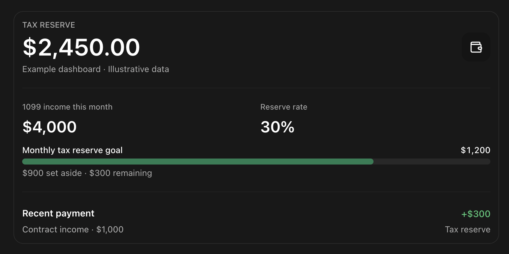

# - Taxable

Taxable is a lightweight 1099 tax-reserve tracker.

# - MVP

The core loop is:

1. User manually records a 1099 payment.
2. Taxable calculates the tax reserve using the user's configured percentage.
3. User manually transfers money to their tax savings account.
4. User records that transfer in Taxable.
5. Dashboard shows required reserve vs. actually saved.

# - Stack

## - Frontend

- Next.js
- TypeScript
- Tailwind CSS
- shadcn/ui
- Sonner

## - Backend

- db - PostgreSQL via supabase
- bank connection - Plaid
- bg jobs - Inngest or scheduled jobs
- Transfers (later) - Banking/payment API, subject to eligibility

# - Important Domain Rule

Calculated tax reserve and actual amount saved are separate values.

Example:
Income: $1,000
Reserve rate: 35%
Required reserve: $350
Actually transferred: $200
Remaining to transfer: $150

## UI Layout Reference

Refer to this image for the target layout, components, and features for this MVP build.

# - Phases

## - Phase 1 (current)

This first MVP is phase 1 and should include an auth layer for me to log in and the bank connection layer to view my transactions (let me choose more than one too).

Build the dashboard, payment entry, configurable reserve percentage, and savings tracking. No bank credentials required.

Do not add (will be for Phase 2, 3, 4):

- Plaid
- Bank integrations
- Expense tracking
- Invoicing
- Tax filing
- Automatic tax calculation
- Complex bookkeeping

## - Phase 2

Connect your checking account through Plaid. Identify eligible deposits, avoid duplicate transactions, and calculate reserves automatically. Production access and pricing may affect the timeline.

## - Phase 3

Investigate authorized transfers to an existing savings account. Build safeguards against duplicate transfers, overdrafts, and failed payments. This is the most difficult part.

## - Phase 4

Add onboarding, user isolation, security reviews, account disconnection, and support for multiple banks. Address financial compliance and operating costs before handling other people's money.
